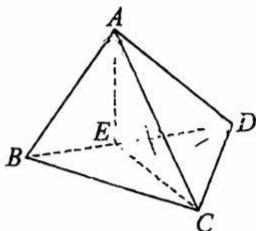
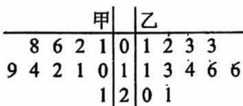

# 2026 学年向明中学 10 月学科检测

# 高三年级数学试卷

## 一、填空题（本大题共有12题,满分54分,第1\~6题每题4分,第7\~12题每题5分）考生应在答题纸的相应位置直接填写结果.

1. 抛物线 $y^{2}=4x$ 的准线方程为 \_\_\_\_.

2. 已知直线 $l_{1}: ax + y - 1 = 0, l_{2}: 2x + 2y - 3 = 0$ ，若 $l_{1} \parallel l_{2}$ ，则实数 a 的值为 \_\_\_\_.

3. 若复数 $z$ 满足 $\mathbf{i} \cdot z = 3 - 4\mathbf{i}$ , 则 $|z| =$ \_\_\_\_.

4. 函数 $f(x)=\frac{1}{\sqrt{x-1}}$ 的定义域为 \_\_\_\_.

5. $(1-2x)^{10}$ 展开式中的 $x^{3}$ 的系数为 \_\_\_\_。（用数字作答）

6. 已知 A、B 两人同时射击目标 C（A、B 是否射中之间相互独立），已知 A 射中 C 的概率为 0.9，B 射中 C 的概率为 0.8，则至少有一人击中目标 C 的概率是 \_\_\_\_。
7. 已知 $ab = 1, 4a^{2} + 9b^{2}$ 的最小值为 \_\_\_\_.

8. 已知圆锥的侧面积为 $20\pi \, cm^{2}$ ，底面半径为 $4 \, cm$ ，则该圆锥的体积是 \_\_\_\_ $cm^{3}$

9. 已知 $F_{1}, F_{2}$ 为双曲线 $\frac{x^{2}}{a^{2}} - \frac{y^{2}}{b^{2}} = 1 (a > 0, b > 0)$ 的左、右焦点，以 $F_{1}F_{2}$ 为直径的圆与双曲线的一条渐近线 $y = \frac{b}{a}x$ 交于点 P，若 $\angle PF_{1}F_{2} = 30^{\circ}$ ，则双曲线的离心率 e = \_\_\_\_. 10. 在平行四边形 ABCD 中，AD = 1, $\angle BAD = 60^{\circ}$ , E 为 CD 的中点，若 $\overrightarrow{AC} \cdot \overrightarrow{BE} = 1$ ，则 AB 的长为 \_\_\_\_.

11.如图,某画框内摆放着三个矩形工艺品,它们的长均为50cm,宽均为10cm.点A、B、C、D在同一条直线上,点F在边BE上,点I在边GH上,测得B、C两点间距离为10cm.为了使 $\angle {BFC} = \angle {HID}$ ,则C、D两点间距离为\_\_\_\_cm.

  
第11题图

12. 如图, 在棱长为 $\sqrt{6}$ 的正方体 $ABCD - A_{1}B_{1}C_{1}D_{1}$ 中, $AC_{1}$ 是它的一条体对角线. 将底面对角线 $BD$ 绕直线 $AC_{1}$ 旋转一周, 则 $BD$ 所扫过区域的面积为 \_\_\_\_.

第12题图

## 二、选择题（本大题共有4题,满分18分,第13、14题每题4分,第15、16题每题5分）每题有且只有一个正确选项。考生应在答题纸的相应位置,将代表正确选项的小方格涂黑。

13. 设函数 $y = \bar{x}^{\frac{3}{2}}$ 的定义域集合为 M，值域集合为 N，则（）
A. $M \subset N$ B. $N \subset M$ C. M = N D. $M \cap N = \varnothing$

14. 已知数列 $\{a_{n}\}$ 是等差数列, $\{b_{n}\}$ 是等比数列, 且 $b_{2}=2, b_{3}=4, a_{1}=b_{1}, a_{8}+1=b_{5}$ , 则数列 $a_{n}=(\quad)$ A. 3n-2 B. 2n-1 C. 2n D. $2n+1$

15. 已知函数 $f(x) = 2\sin \left( \omega x - \frac{\pi}{4} \right) (\omega > 0)$ 在区间 $[0, 2\pi]$ 上存在零点，且函数 $f(x)$ 在区间 $[0, 2\pi]$ 上的值域为 $M \subseteq [-\sqrt{2}, 2]$ ，则 $\omega$ 的取值范围是（）A. $\left[\frac{1}{4}, \frac{3}{2}\right]$ B. $\left[\frac{1}{8}, \frac{3}{4}\right]$ C. $\left[\frac{1}{8}, \frac{4}{3}\right]$ D. $\left[\frac{1}{8}, 1\right]$

16. 已知平面向量 $\bar{a}, \bar{b}, \bar{c}$ ，对任意实数 x, y 都有 $\left|\vec{a}-x\vec{b}\right| \geq \left|\vec{a}-\vec{b}\right|, \left|\vec{a}-y\vec{c}\right| \geq \left|\vec{a}-\vec{c}\right|$ 成立。若 $\left|\vec{a}\right|=2$ ，则 $\vec{b} \cdot (\vec{c}-\vec{a})$ 的最大值是（）

A. $\frac{1}{2}$ B. $\sqrt{5}-\sqrt{3}$ C. $\frac{\sqrt{2}}{2}$ D. $\sqrt{3}-1$

## 三、解答题（本大题共有5题，满分78分）解答下列各题必须在答题纸的相应位置写出必要的步骤.

17.（本题共两小题,第一小题6分,第二小题8分,满分14分）

如图,三棱锥 A-BCD 中,点 E 在 BD 上, $AE \perp CE$ , $AE \perp DE$ , $CD \perp AD$ .

(1)证明： $CD \perp AB$ ;

(2)若 $DE = 2, BE = 1, AE = \sqrt{2}, CD = 2\sqrt{3}$ , 求直线 $AD$ 与平面 $ABC$ 所成角的正弦值.

## 18.（本题共两小题,第一小题6分,第二小题8分,满分14分）

$$
f (x) = \log_ {a} x (a > 0, a \neq 1)
$$

(1) 若 $y = f(x)$ 过 $(4,2)$ ，解方程 $f(2x^{2} - 3) = f(x)$ ;

(2)若存在 $x$ 使得 $f(x + 1)$ 、 $f(ax)$ 、 $f(x + 2)$ 成等差数列，求 $a$ 的取值范围.

19.（本题共三小题,第一小题4分,第二小题4分,第三小题6分,满分14分）为培养学生的阅读习惯,某校开展了为期一年的“弘扬传统文化,阅读经典名著”活动.活动后,学校统计了甲、乙两组学生的阅读量（单位：本）,统计结果用茎叶图记录如图所示（十位数字作为“茎”,个位数字作为“叶”）.

(1)分别写出甲、乙两组阅读量的第60百分位数；

(2)从甲、乙两组学生中随机抽取 2 人,求其中恰有 1 人的阅读量超过 15 本的概率;

(3)为使两组人数相同,在甲组中增加一名阅读量为 $a$ ( $a \in \mathbb{N}$ ) 的组员,若加入后甲组阅读量的均值增大,但方差没有增大,求 $a$ 的所有可能取值.

20.（本题共三小题,第一小题4分,第二小题6分,第三小题8分,满分18分）在平面直角坐标系中,已知曲线 $\Gamma: \frac{x^2}{4} + y^2 = 1 (y \geq 0)$ , 点 $P$ 、 $Q$ 分别为 $\Gamma$ 上不同的两点, $T(t,0)$ .

(1)求 $\Gamma$ 所在椭圆的离心率;

(2)若 $T(1,0),Q$ 在 $\pmb{y}$ 轴上，若 $T$ 到直线 $PQ$ 的距离为 $\frac{\sqrt{5}}{5}$ 求 $P$ 的坐标；

(3)是否存在 t, 使得 $\Delta TPQ$ 是以 T 为直角顶点的等腰直角三角形？若存在，求 t 的取值范围；若不存在，请说明理由.

21.（本题共三小题,第一小题4分,第二小题6分,第三小题8分,满分18分）
三个互不相同的函数 $y=f(x)$ , $y=g(x)$ 与 $y=h(x)$ 在区间 D 上恒有 $f(x)\geq h(x)\geq g(x)$ 或恒有 $f(x)\leq h(x)\leq g(x)$ ，则称 $y=h(x)$ 为 $y=f(x)$ 与 $y=g(x)$ 在区间 D 上的“分割函数”.
(1)设 $h_{1}(x)=4x, h_{2}(x)=x+1$ ，试分别判断 $y=h_{1}(x)$ 、 $y=h_{2}(x)$ 是否是 $y=2x^{2}+2$ 与 $y=-x^{2}+4x$ 在区间上的“分割函数”，请说明理由；
(2)若二次函数 $h_{3}(x)=ax^{2}+bx+c$ 是 $y=2x^{2}+2$ 与 y=4x 在区间 $(-∞,+∞)$ 上的“分割函数”，求所有的二次函数 $h_{3}(x)$ . （用 a 表示）
(3) 若 $[m,n] \subseteq [-2,2]$ ，且存在实数 k, b，使得 $y = kx + b$ 为 $y = x^{4} - 4x^{2}$ 与 $y = 4x^{2} - 16$ 在区间 $[m,n]$ 上的“分割函数”，求 n-m 的最大值.