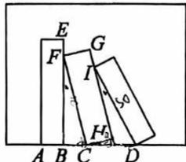
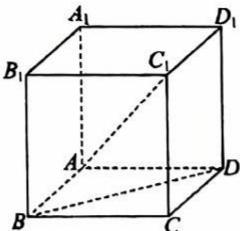
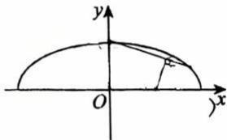

# 2026学年向明中学10月学科检测 高三年级数学试卷（教师版）

## 一、填空题（本大题共有12题，满分54分，第1~6题每题4分，第7~12题每题5分）考生应在答题纸的相应位置直接填写结果.

**1.** 抛物线 $y^2=4x$ 的准线方程为 \_\_\_\_.

**答案** $x=-1$

**解析** 由 $y^2=4x$ 得 $2p=4$，即 $p=2$，抛物线开口向右，准线方程为 $x=-\dfrac{p}{2}=-1$。

**2.** 已知直线 $l_1: ax+y-1=0, l_2: 2x+2y-3=0$，若 $l_1 \parallel l_2$，则实数 $a$ 的值为 \_\_\_\_.

**答案** $1$

**解析** $l_2$ 化为 $y=-x+\dfrac32$，斜率为 $-1$。$l_1$ 化为 $y=-ax+1$，斜率为 $-a$。由 $l_1\parallel l_2$ 得 $-a=-1$，即 $a=1$。此时 $l_1:x+y-1=0$，$l_2:x+y-\dfrac32=0$，两直线平行且不重合，故 $a=1$。

**3.** 若复数 $z$ 满足 $\mathrm{i} \cdot z = 3-4\mathrm{i}$，则 $|z| =$ \_\_\_\_.

**答案** $5$

**解析** 两边取模：$|\mathrm{i}\cdot z|=|\mathrm{i}|\cdot|z|=|z|$，而 $|3-4\mathrm{i}|=\sqrt{3^2+(-4)^2}=5$，故 $|z|=5$。

**4.** 函数 $f(x)=\dfrac{1}{\sqrt{x-1}}$ 的定义域为 \_\_\_\_.

**答案** $(1,+\infty)$

**解析** 需使根式有意义且分母不为零，即 $x-1>0$，得 $x>1$，故定义域为 $(1,+\infty)$。

**5.** $(1-2x)^{10}$ 展开式中的 $x^3$ 的系数为 \_\_\_\_.（用数字作答）

**答案** $-960$

**解析** 展开式的通项为 $T_{k+1}=\mathrm{C}_{10}^{k}\cdot 1^{10-k}\cdot(-2x)^{k}=\mathrm{C}_{10}^{k}(-2)^k x^k$，令 $k=3$，得 $x^3$ 的系数为 $\mathrm{C}_{10}^{3}(-2)^3=120\times(-8)=-960$。

**6.** 已知 $A$、$B$ 两人同时射击目标 $C$（$A$、$B$ 是否射中之间相互独立），已知 $A$ 射中 $C$ 的概率为 $0.9$，$B$ 射中 $C$ 的概率为 $0.8$，则至少有一人击中目标 $C$ 的概率是 \_\_\_\_.

**答案** $0.98$

**解析** 记 $A$ 射中 $C$ 为事件 $M$，$B$ 射中 $C$ 为事件 $N$，由题意 $M$、$N$ 相互独立，$P(M)=0.9$，$P(N)=0.8$。至少一人击中 $C$ 的对立事件是"两人都未击中 $C$"，其概率为 $(1-0.9)\times(1-0.8)=0.1\times0.2=0.02$，故所求概率为 $1-0.02=0.98$。

**7.** 已知 $ab=1$，$4a^2+9b^2$ 的最小值为 \_\_\_\_.

**答案** $12$

**解析** 由 $ab=1>0$ 知 $a$、$b$ 同号。由基本不等式
$$4a^2+9b^2\ge 2\sqrt{4a^2\cdot 9b^2}=2\sqrt{36(ab)^2}=12|ab|=12,$$
等号当且仅当 $4a^2=9b^2$ 且 $ab=1$ 时成立（例如取 $a^2=\dfrac32$，$b^2=\dfrac23$，此时 $4a^2=6=9b^2$），所以最小值为 $12$。

**8.** 已知圆锥的侧面积为 $20\pi\,\mathrm{cm}^2$，底面半径为 $4\,\mathrm{cm}$，则该圆锥的体积是 \_\_\_\_ $\mathrm{cm}^3$.

**答案** $16\pi$

**解析** 设母线长为 $l$。底面半径 $r=4$，由侧面积公式 $\pi r l=20\pi$ 得 $l=5$。圆锥的高 $h=\sqrt{l^2-r^2}=\sqrt{25-16}=3$，故体积 $V=\dfrac13\pi r^2 h=\dfrac13\pi\cdot 16\cdot 3=16\pi$。

**9.** 已知 $F_1, F_2$ 为双曲线 $\dfrac{x^2}{a^2}-\dfrac{y^2}{b^2}=1\,(a>0, b>0)$ 的左、右焦点，以 $F_1F_2$ 为直径的圆与双曲线的一条渐近线 $y=\dfrac{b}{a}x$ 交于点 $P$，若 $\angle PF_1F_2=30^{\circ}$，则双曲线的离心率 $e=$ \_\_\_\_.

**答案** $2$

**解析** 焦距 $c=\sqrt{a^2+b^2}$，$F_1(-c,0)$，$F_2(c,0)$。以 $F_1F_2$ 为直径的圆为 $x^2+y^2=c^2$。与渐近线 $y=\dfrac{b}{a}x$ 联立得 $x^2+\dfrac{b^2}{a^2}x^2=c^2$，即 $x^2\cdot\dfrac{a^2+b^2}{a^2}=c^2$，故 $x^2=a^2$，取第一象限交点 $P(a,b)$。
在 $\triangle PF_1F_2$ 中，$\overrightarrow{F_1P}=(a+c,\,b)$，$\overrightarrow{F_1F_2}=(2c,0)$，于是
$$\tan\angle PF_1F_2=\frac{b}{a+c}=\tan 30^{\circ}=\frac{\sqrt3}{3},$$
即 $\sqrt3 b=a+c$。又 $c^2=a^2+b^2$，代入 $b=\dfrac{a+c}{\sqrt3}$ 得
$$3c^2=3a^2+(a+c)^2=4a^2+2ac+c^2,$$
整理得 $c^2-ac-2a^2=0$，即 $e^2-e-2=0$，解得 $e=2$（$e=-1$ 舍去）。故 $e=2$。

**10.** 在平行四边形 $ABCD$ 中，$AD=1$，$\angle BAD=60^{\circ}$，$E$ 为 $CD$ 的中点，若 $\overline{AC} \cdot \overline{BE}=1$，则 $AB$ 的长为 \_\_\_\_.

**答案** $\dfrac12$

**解析** 以 $A$ 为原点、$\overrightarrow{AB}$ 方向为 $x$ 轴正方向建立平面直角坐标系，设 $AB=m$。由 $AD=1$，$\angle BAD=60^{\circ}$ 得
$$B(m,0),\quad D\left(\frac12,\frac{\sqrt3}{2}\right),\quad C\left(m+\frac12,\frac{\sqrt3}{2}\right).$$
$E$ 为 $CD$ 中点，故 $E\left(\dfrac{m+1}{2},\dfrac{\sqrt3}{2}\right)$。于是
$$\overrightarrow{AC}=\left(m+\frac12,\frac{\sqrt3}{2}\right),\qquad \overrightarrow{BE}=\left(\frac{1-m}{2},\frac{\sqrt3}{2}\right),$$
$$\overrightarrow{AC}\cdot\overrightarrow{BE}=\frac{(2m+1)(1-m)}{4}+\frac34=-\frac{m^2}{2}+\frac m4+1.$$
由 $\overrightarrow{AC}\cdot\overrightarrow{BE}=1$ 得 $-\dfrac{m^2}{2}+\dfrac m4=0$，即 $m(2m-1)=0$；由 $m>0$ 得 $m=\dfrac12$，故 $AB=\dfrac12$。

**11.** 如图，某画框内摆放着三个矩形工艺品，它们的长均为 $50\mathrm{cm}$，宽均为 $10\mathrm{cm}$. 点 $A$、$B$、$C$、$D$ 在同一条直线上，点 $F$ 在边 $BE$ 上，点 $I$ 在边 $GH$ 上，测得 $B$、$C$ 两点间距离为 $10\mathrm{cm}$. 为了使 $\angle BFC=\angle HID$，则 $C$、$D$ 两点间距离为 \_\_\_\_ $\mathrm{cm}$.

第11题图

**答案** $\dfrac{25\sqrt6}{3}$（约 $20.4$）

**解析** 记三个矩形依次为①②③，长 $50$、宽 $10$，且①竖直放置。
①的下边为 $AB$，故 $AB=10$；又 $BC=10$，以 $A$ 为原点、直线 $ABCD$ 为 $x$ 轴建立坐标系，则
$$A(0,0),\quad B(10,0),\quad C(20,0),\quad E(10,50).$$
②的左上顶点 $F$ 落在①的右边 $BE$ 上，左下顶点为 $C$，故 $FC$ 是②的长边，$|FC|=50$。设 $\angle BFC=\theta$，则
$$\sin\theta=\frac{BC}{FC}=\frac{10}{50}=\frac15,\qquad \cos\theta=\frac{2\sqrt6}{5},\qquad \tan\theta=\frac{1}{2\sqrt6},$$
且 $F=(10,\,50\cos\theta)=(10,\,20\sqrt6)$。
②的右上顶点 $G=F+10(\cos\theta,\sin\theta)=\left(10+4\sqrt6,\ 20\sqrt6+2\right)$，右下顶点 $H=C+10(\cos\theta,\sin\theta)=\left(20+4\sqrt6,\ 2\right)$。
③的左上顶点 $I$ 落在②的右边 $GH$ 上，记 $\boldsymbol u=(\sin\theta,-\cos\theta)$（即 $GH$ 向下的方向），则 $I=G+s\boldsymbol u\ (0<s<50)$。由 $\angle HID=\angle BFC=\theta$，又③的长边向下、其下端 $D$ 在直线 $ABCD$ 上，故③的长边方向为 $(\sin2\theta,-\cos2\theta)$，其中
$$\sin2\theta=2\sin\theta\cos\theta=\frac{4\sqrt6}{25},\qquad \cos2\theta=\cos^2\theta-\sin^2\theta=\frac{23}{25}.$$
由 $D=I+50(\sin2\theta,-\cos2\theta)$ 的纵坐标为 $0$，
$$20\sqrt6+2-50\cos2\theta-s\cos\theta=0,$$
代入 $\cos\theta=\dfrac{2\sqrt6}{5}$，$\cos2\theta=\dfrac{23}{25}$ 解得 $s=\dfrac{5(20\sqrt6-44)}{2\sqrt6}$。
于是 $C$、$D$ 两点的水平距离
$$CD=10+12\sqrt6+\frac s5-20=12\sqrt6-10+\left(10-\frac{11\sqrt6}{3}\right)=\frac{25\sqrt6}{3}.$$
故 $C$、$D$ 两点间距离为 $\dfrac{25\sqrt6}{3}\,\mathrm{cm}$。

**12.** 如图，在棱长为 $\sqrt6$ 的正方体 $ABCD-A_1B_1C_1D_1$ 中，$AC_1$ 是它的一条体对角线. 将底面对角线 $BD$ 绕直线 $AC_1$ 旋转一周，则 $BD$ 所扫过区域的面积为 \_\_\_\_.

第12题图

**答案** $3\pi$

**解析** 以 $A$ 为原点，$AB$、$AD$、$AA_1$ 为 $x$、$y$、$z$ 轴建立空间直角坐标系，棱长 $a=\sqrt6=\sqrt6$。则
$$A(0,0,0),\ B(a,0,0),\ D(0,a,0),\ C(a,a,0),\ C_1(a,a,a),$$
体对角线 $AC_1$ 的方向向量可取 $\boldsymbol d=(1,1,1)$。
点 $B$ 到直线 $AC_1$ 的距离
$$d_B=\frac{|\overrightarrow{AB}\times\boldsymbol d|}{|\boldsymbol d|}=\frac{|(a,0,0)\times(1,1,1)|}{\sqrt3}=\frac{\sqrt{0+a^2+a^2}}{\sqrt3}=\frac{a\sqrt2}{\sqrt3}=\sqrt6\cdot\sqrt{\frac23}=2.$$
又 $\overrightarrow{BD}=(-a,a,0)$，$\overrightarrow{BD}\cdot\boldsymbol d=-a+a+0=0$，即 $BD\perp AC_1$，故 $BD$ 完全落在过其中点、垂直于 $AC_1$ 的平面内。$BD$ 中点 $M\left(\dfrac a2,\dfrac a2,0\right)$ 到 $AC_1$ 的距离为
$$d_M=\frac{|\overrightarrow{AM}\times\boldsymbol d|}{|\boldsymbol d|}=\frac{\left|\left(\frac a2,\frac a2,0\right)\times(1,1,1)\right|}{\sqrt3}=\frac{\sqrt{\left(-\frac a2\right)^2+\left(\frac a2\right)^2+0}}{\sqrt3}=\frac{a}{\sqrt6}=1.$$
因此 $BD$ 绕 $AC_1$ 旋转一周时，其上各点到轴的距离从 $1$ 连续变化到 $2$，扫过的区域是该垂面内以 $M$ 的轴投影为中心、内半径为 $1$、外半径为 $2$ 的圆环，其面积
$$S=\pi(2^2-1^2)=3\pi.$$

## 二、选择题（本大题共有4题，满分18分，第13、14题每题4分，第15、16题每题5分）每题有且只有一个正确选项。考生应在答题纸的相应位置，将代表正确选项的小方格涂黑。

**13.** 设函数 $y=x^{-\frac{3}{2}}$ 的定义域集合为 $M$，值域集合为 $N$，则（　　）

A. $M \subset N$　B. $N \subset M$　C. $M=N$　D. $M \cap N=\varnothing$

**答案** C

**解析** $y=x^{-\frac32}=\dfrac{1}{\sqrt{x^3}}$，需 $x>0$，故定义域 $M=(0,+\infty)$。当 $x>0$ 时 $x^{\frac32}>0$，故 $y=\dfrac{1}{x^{\frac32}}>0$，值域 $N=(0,+\infty)$。所以 $M=N$，选 C。

**14.** 已知数列 $\{a_n\}$ 是等差数列，$\{b_n\}$ 是等比数列，且 $b_2=2$，$b_3=4$，$a_1=b_1$，$a_8+1=b_5$，则数列 $a_n=$（　　）

A. $3n-2$　B. $2n-1$　C. $2n$　D. $2n+1$

**答案** B

**解析** 等比数列 $\{b_n\}$ 中，公比 $q=\dfrac{b_3}{b_2}=2$，$b_1=\dfrac{b_2}{q}=1$，故 $b_5=b_1q^4=16$。于是 $a_1=b_1=1$，$a_8=b_5-1=15$。设 $\{a_n\}$ 公差为 $d$，则 $a_8=a_1+7d=1+7d=15$，得 $d=2$，故 $a_n=1+(n-1)\times2=2n-1$，选 B。

**15.** 已知函数 $f(x)=2\sin\left(\omega x-\frac{\pi}{4}\right)\,(\omega>0)$ 在区间 $[0,2\pi]$ 上存在零点，且函数 $f(x)$ 在区间 $[0,2\pi]$ 上的值域为 $M \subseteq [-\sqrt{2}, 2]$，则 $\omega$ 的取值范围是（　　）

A. $\left[\frac{1}{4}, \frac{3}{2}\right]$　B. $\left[\frac{1}{8}, \frac{3}{4}\right]$　C. $\left[\frac{1}{8}, \frac{4}{3}\right]$　D. $\left[\frac{1}{8}, 1\right]$

**答案** B

**解析** 令 $t=\omega x-\dfrac{\pi}{4}$。当 $x\in[0,2\pi]$ 时 $t\in\left[-\dfrac{\pi}{4},\,2\pi\omega-\dfrac{\pi}{4}\right]$，$f(x)=2\sin t$。
由值域 $M\subseteq[-\sqrt2,2]$ 知对上述所有 $t$ 都有 $2\sin t\ge-\sqrt2$，即 $\sin t\ge-\dfrac{\sqrt2}{2}$。因为区间左端点为 $-\dfrac{\pi}{4}$（此处 $\sin t=-\dfrac{\sqrt2}{2}$），而 $\sin t\ge-\dfrac{\sqrt2}{2}$ 要求 $t\le\dfrac{5\pi}{4}$，故
$$2\pi\omega-\frac{\pi}{4}\le\frac{5\pi}{4}\ \Longrightarrow\ \omega\le\frac34 .$$
又 $f$ 在 $[0,2\pi]$ 上存在零点，而 $t=0$ 对应零点，需 $0\in\left[-\dfrac{\pi}{4},2\pi\omega-\dfrac{\pi}{4}\right]$，即 $2\pi\omega-\dfrac{\pi}{4}\ge0$，得 $\omega\ge\dfrac18$。
综上 $\omega\in\left[\dfrac18,\dfrac34\right]$，选 B。

**16.** 已知平面向量 $\bar{a}, \bar{b}, \bar{c}$，对任意实数 $x, y$ 都有 $\left|\bar{a}-x\bar{b}\right| \geq \left|\bar{a}-\bar{b}\right|$，$\left|\bar{a}-y\bar{c}\right| \geq \left|\bar{a}-\bar{c}\right|$ 成立. 若 $\left|\bar{a}\right|=2$，则 $\bar{b} \cdot (\bar{c}-\bar{a})$ 的最大值是（　　）

A. $\frac{1}{2}$　B. $\sqrt{5}-\sqrt{3}$　C. $\frac{\sqrt{2}}{2}$　D. $\sqrt{3}-1$

**答案** A

**解析** 记 $f(x)=|\bar a-x\bar b|^2=|\bar a|^2-2x(\bar a\cdot\bar b)+x^2|\bar b|^2$。由 $f(x)\ge f(1)$ 对任意实数 $x$ 成立知 $x=1$ 是 $f$ 的最小值点，故 $\dfrac{\bar a\cdot\bar b}{|\bar b|^2}=1$，即 $\bar a\cdot\bar b=|\bar b|^2$（同理由 $\bar a\cdot\bar c=|\bar c|^2$）。
取 $\bar a=(2,0)$。由 $\bar a\cdot\bar b=|\bar b|^2$ 得 $2b_1=b_1^2+b_2^2$，即 $(b_1-1)^2+b_2^2=1$，故 $\bar b$ 的终点在以 $(1,0)$ 为圆心、$1$ 为半径的圆上，可设 $\bar b=(1+\cos\alpha,\sin\alpha)$；同理 $\bar c=(1+\cos\beta,\sin\beta)$。于是
$$\bar b\cdot(\bar c-\bar a)=(1+\cos\alpha)(1+\cos\beta)+\sin\alpha\sin\beta-2(1+\cos\alpha)$$
$$=-1-\cos\alpha+\cos\beta+\cos(\alpha-\beta).$$
令其对 $\alpha,\beta$ 的偏导为零得 $\sin\alpha=\sin\beta=\sin(\alpha-\beta)$，解得所有驻点的函数值为 $0$ 或 $\dfrac12$。故最大值为 $\dfrac12$，选 A。（此时 $\alpha=\dfrac{2\pi}{3}$，$\beta=\dfrac{\pi}{3}$，即 $\bar b=\left(\dfrac12,\dfrac{\sqrt3}{2}\right)$，$\bar c=\left(\dfrac32,\dfrac{\sqrt3}{2}\right)$。）

## 三、解答题（本大题共有5题，满分78分）解答下列各题必须在答题纸的相应位置写出必要的步骤.

**17.**（本题共两小题，第一小题6分，第二小题8分，满分14分）

如图，三棱锥 $A-BCD$ 中，点 $E$ 在 $BD$ 上，$AE \perp CE$，$AE \perp DE$，$CD \perp AD$.

(1) 证明：$CD \perp AB$；

(2) 若 $DE=2$，$BE=1$，$AE=\sqrt{2}$，$CD=2\sqrt{3}$，求直线 $AD$ 与平面 $ABC$ 所成角的正弦值.

**答案** (1) 证明见解析；(2) $\dfrac{\sqrt6}{3}$

**解析** (1) 因为 $AE\perp CE$，$AE\perp DE$，且 $CE$、$DE$ 是平面 $CDE$ 内两条相交直线，所以 $AE\perp$ 平面 $CDE$，从而 $AE\perp CD$。
又已知 $CD\perp AD$，且 $AE$、$AD$ 是平面 $ADE$ 内两条相交直线，所以 $CD\perp$ 平面 $ADE$。
因为 $E$ 在 $BD$ 上，所以 $B$、$E$、$D$ 三点共线，$B\in$ 平面 $ADE$，从而 $AB\subset$ 平面 $ADE$。于是 $CD\perp AB$。

(2) 由 $AE\perp$ 平面 $CDE$，以 $E$ 为原点，$EA$ 所在直线为 $z$ 轴，平面 $CDE$ 为 $xEy$ 平面建立空间直角坐标系。设 $D(2,0,0)$（因 $DE=2$），由 $E$ 在 $BD$ 上且 $BE=1$，取 $B(-1,0,0)$，$A(0,0,\sqrt2)$。
设 $C(x,y,0)$。由 $CD\perp AD$，$\overrightarrow{AD}=(2,0,-\sqrt2)$，$\overrightarrow{DC}=(x-2,y,0)$，得
$$\overrightarrow{AD}\cdot\overrightarrow{DC}=2(x-2)+0+0=0\ \Longrightarrow\ x=2,$$
故 $C(2,y,0)$。由 $CD=2\sqrt3$ 得 $|y|=2\sqrt3$，取 $C(2,2\sqrt3,0)$。
$\overrightarrow{AB}=(-1,0,-\sqrt2)$，$\overrightarrow{AC}=(2,2\sqrt3,-\sqrt2)$。设平面 $ABC$ 的法向量 $\boldsymbol n=\overrightarrow{AB}\times\overrightarrow{AC}$，则
$$\boldsymbol n=(2\sqrt6,\ -3\sqrt2,\ -2\sqrt3),\qquad |\boldsymbol n|=\sqrt{24+18+12}=3\sqrt6 .$$
又 $\overrightarrow{AD}=(2,0,-\sqrt2)$，$|\overrightarrow{AD}|=\sqrt6$，$\overrightarrow{AD}\cdot\boldsymbol n=2\times2\sqrt6+0+(-\sqrt2)(-2\sqrt3)=6\sqrt6$。
设直线 $AD$ 与平面 $ABC$ 所成角为 $\varphi$，则
$$\sin\varphi=\frac{|\overrightarrow{AD}\cdot\boldsymbol n|}{|\overrightarrow{AD}|\cdot|\boldsymbol n|}=\frac{6\sqrt6}{\sqrt6\cdot3\sqrt6}=\frac{\sqrt6}{3}.$$
故所成角的正弦值为 $\dfrac{\sqrt6}{3}$。

**18.**（本题共两小题，第一小题6分，第二小题8分，满分14分）

若 $f(x)=\log_a x\,(a>0, a \neq 1)$.

(1) 若 $y=f(x)$ 过 $(4,2)$，解方程 $f(2x^2-3)=f(x)$；

(2) 若存在 $x$ 使得 $f(x+1)$、$f(ax)$、$f(x+2)$ 成等差数列，求 $a$ 的取值范围.

**答案** (1) $a=2$，$x=\dfrac32$；(2) $a>1$

**解析** (1) 由 $f(x)=\log_a x$ 过点 $(4,2)$ 得 $\log_a 4=2$，即 $a^2=4$，由 $a>0$ 且 $a\ne1$ 得 $a=2$。
方程 $f(2x^2-3)=f(x)$ 即 $\log_2(2x^2-3)=\log_2 x$，等价于
$$\begin{cases}2x^2-3=x\\ x>0\\ 2x^2-3>0\end{cases}$$
由 $2x^2-x-3=0$ 得 $(2x-3)(x+1)=0$，故 $x=\dfrac32$ 或 $x=-1$。结合 $x>0$ 舍去 $x=-1$，此时 $2x^2-3=\dfrac32>0$ 满足，故 $x=\dfrac32$。

(2) $f(x+1)$、$f(ax)$、$f(x+2)$ 成等差数列，即
$$2f(ax)=f(x+1)+f(x+2).$$
由对数有意义，需 $x+1>0$，$x+2>0$，$ax>0$；又 $a>0$，故 $x>\max\{-1,0\}=0$（当 $x\le0$ 时 $ax\le0$，$\log_a(ax)$ 无意义）。在此前提下
$$2\log_a(ax)=\log_a(x+1)+\log_a(x+2)\ \Longleftrightarrow\ \log_a\left(a^2x^2\right)=\log_a\left[(x+1)(x+2)\right],$$
等价于 $a^2x^2=(x+1)(x+2)=x^2+3x+2$，即
$$(a^2-1)x^2-3x-2=0.$$
记 $g(x)=(a^2-1)x^2-3x-2$。
若 $a>1$，则 $a^2-1>0$，$g(0)=-2<0$，当 $x\to+\infty$ 时 $g(x)\to+\infty$，故 $g$ 在 $(0,+\infty)$ 上存在零点，满足条件。
若 $0<a<1$，则 $a^2-1<0$，对一切 $x>0$ 都有 $g(x)=(a^2-1)x^2-3x-2<0$，无正根，不满足条件。
综上，$a$ 的取值范围是 $(1,+\infty)$。

**19.**（本题共三小题，第一小题4分，第二小题4分，第三小题6分，满分14分）

为培养学生的阅读习惯，某校开展了为期一年的“弘扬传统文化，阅读经典名著”活动. 活动后，学校统计了甲、乙两组学生的阅读量（单位：本），统计结果用茎叶图记录如图所示（十位数字作为“茎”，个位数字作为“叶”）.

(1) 分别写出甲、乙两组阅读量的第60百分位数；

(2) 从甲、乙两组学生中随机抽取2人，求其中恰有1人的阅读量超过15本的概率；

(3) 为使两组人数相同，在甲组中增加一名阅读量为 $a$（$a \in \mathrm{N}$）的组员，若加入后甲组阅读量的均值增大，但方差没有增大，求 $a$ 的所有可能取值.

**答案** (1) 甲组 $11.5$，乙组 $14$；(2) $\dfrac37$；(3) $a\in\{11,12,13,14,15,16\}$

**解析** 由茎叶图，甲组 $10$ 人：$1,2,6,8,10,11,12,14,19,21$；乙组 $11$ 人：$1,2,3,3,11,13,14,16,16,20,21$。

(1) 甲组数据已按从小到大排列，共 $10$ 个，$10\times60\%=6$ 为整数，故第 $60$ 百分位数为第 $6$、$7$ 个数据的平均数：
$$\frac{11+12}{2}=11.5 .$$
乙组共 $11$ 个，$11\times60\%=6.6$ 不是整数，取大于 $6.6$ 的最小整数 $7$，故第 $60$ 百分位数为第 $7$ 个数据 $14$。

(2) 甲组阅读量超过 $15$ 本的有 $19,21$ 共 $2$ 人，乙组超过 $15$ 本的有 $16,16,20,21$ 共 $4$ 人，合计 $6$ 人；两组共 $21$ 人。
从 $21$ 人中任取 $2$ 人共有 $\mathrm{C}_{21}^{2}=210$ 种取法；其中恰有 $1$ 人阅读量超过 $15$ 本的取法为 $\mathrm{C}_{6}^{1}\mathrm{C}_{15}^{1}=6\times15=90$ 种。故所求概率
$$P=\frac{90}{210}=\frac37 .$$

(3) 设甲组原有 $10$ 个数据的平均数为 $\bar x$，方差为 $s^2$。由 (1) 中数据
$$\sum_{i=1}^{10}x_i=104,\qquad \sum_{i=1}^{10}x_i^2=1468,$$
故 $\bar x=10.4$，$s^2=\dfrac{1468}{10}-10.4^2=146.8-108.16=38.64$。
加入 $a$ 后，平均数 $\bar x'=\dfrac{104+a}{11}$，方差
$$s'^2=\frac{1468+a^2}{11}-\left(\frac{104+a}{11}\right)^2=\frac{10a^2-208a+5332}{121}.$$
由均值增大：$\dfrac{104+a}{11}>10.4$ 得 $a>10.4$，即 $a\ge11$。
由方差没有增大：$s'^2\le s^2$，即
$$\frac{10a^2-208a+5332}{121}\le 38.64\ \Longleftrightarrow\ 125a^2-2600a+8207\le0,$$
解得 $3.9<a<16.9$（两根约为 $3.88$ 与 $16.92$），即整数 $a$ 满足 $4\le a\le16$。
综上，$a$ 的所有可能取值为 $11,12,13,14,15,16$。

**20.**（本题共三小题，第一小题4分，第二小题6分，第三小题8分，满分18分）

在平面直角坐标系中，已知曲线 $\Gamma: \frac{x^2}{4}+y^2=1\,(y \geq 0)$，点 $P$、$Q$ 分别为 $\Gamma$ 上不同的两点，$T(t,0)$.

(1) 求 $\Gamma$ 所在椭圆的离心率；

(2) 若 $T(1,0)$，$Q$ 在 $y$ 轴上，若 $T$ 到直线 $PQ$ 的距离为 $\frac{\sqrt{5}}{5}$，求 $P$ 的坐标；

(3) 是否存在 $t$，使得 $\triangle TPQ$ 是以 $T$ 为直角顶点的等腰直角三角形？若存在，求 $t$ 的取值范围；若不存在，请说明理由.

**答案** (1) $\dfrac{\sqrt3}{2}$；(2) $P(2,0)$；(3) 存在，$t\in\left[-\dfrac65,\dfrac65\right]$

**解析** (1) 曲线 $\Gamma$ 所在椭圆为 $\dfrac{x^2}{4}+y^2=1$，即 $a^2=4$，$b^2=1$，$c^2=a^2-b^2=3$，故离心率
$$e=\frac ca=\frac{\sqrt3}{2}.$$

(2) $Q$ 在 $y$ 轴上，且 $Q\in\Gamma$ 且 $y_Q\ge0$，故 $Q(0,1)$。设 $P(2\cos\theta,\sin\theta)$（$\theta\in[0,\pi]$）。直线 $PQ$ 的方程为
$$( \sin\theta-1)x-2\cos\theta\, y+2\cos\theta=0 .$$
点 $T(1,0)$ 到直线 $PQ$ 的距离为
$$\frac{|\sin\theta-1+2\cos\theta|}{\sqrt{(\sin\theta-1)^2+4\cos^2\theta}}=\frac{\sqrt5}{5}.$$
记 $s=\sin\theta$，$c=\cos\theta$，两边平方并化简（$(\sin\theta-1)^2+4\cos^2\theta=5-2s-3s^2$）得
$$(1-s)(5c-3s-5)=0 .$$
若 $s=1$，则 $P(0,1)=Q$，与 $P$、$Q$ 不同矛盾；故 $5c=3s+5$。联立 $c^2+s^2=1$ 得 $34s^2+30s=0$，即 $s=0$（$s=-\dfrac{15}{17}$ 使 $c=\dfrac{8}{17}$，但 $s<0$ 与 $y_P\ge0$ 矛盾，舍去）。由 $s=0$，$c=1$，得 $P(2,0)$。经检验 $T(1,0)$ 到直线 $PQ:x+2y-2=0$ 的距离为 $\dfrac{1}{\sqrt5}=\dfrac{\sqrt5}{5}$，故 $P(2,0)$。

(3) 存在。设 $P(x,y)\in\Gamma$（$y\ge0$）。因为 $T$ 为直角顶点且 $|TP|=|TQ|$，所以 $\overrightarrow{TQ}$ 由 $\overrightarrow{TP}$ 绕 $T$ 旋转 $90^{\circ}$ 得到。以 $\overrightarrow{TQ}=R_{90^{\circ}}(\overrightarrow{TP})$ 为例，
$$Q\bigl(t-y,\ x-t\bigr).$$
记 $u=x-t$，$v=y$，则 $P(t+u,\,v)$，$Q(t-v,\,u)$，由 $P$、$Q$ 在 $\Gamma$ 的 $y\ge0$ 部分知 $u\ge0$，$v\ge0$。由 $P,Q\in\Gamma$：
$$\frac{(t+u)^2}{4}+v^2=1,\qquad \frac{(t-v)^2}{4}+u^2=1 .$$
两式相减得 $(u+v)\bigl[2t-3(u-v)\bigr]=0$。若 $u+v=0$，则 $u=v=0$，此时 $P=Q=T$，不合题意；故
$$t=\frac32(u-v).$$
令 $s=u+v$，$d=u-v$，两式相加并整理得 $5s^2+20d^2=16$。由 $u,v\ge0$ 得 $s\ge|d|$，即
$$d^2\le s^2=\frac{16-20d^2}{5}\ \Longrightarrow\ d^2\le\frac{16}{25}\ \Longrightarrow\ |d|\le\frac45,$$
从而 $|t|=\dfrac32|d|\le\dfrac65$。
反之，对任意 $t\in\left[-\dfrac65,\dfrac65\right]$，取 $d=\dfrac{2t}{3}$，$s=\sqrt{\dfrac{16-20d^2}{5}}$，则 $s\ge|d|$，令 $u=\dfrac{s+d}{2}$，$v=\dfrac{s-d}{2}$，即可构造出满足条件的 $P$、$Q$（另一方向旋转同理，$t$ 的取值关于原点对称）。
所以存在这样的 $t$，且 $t$ 的取值范围为 $\left[-\dfrac65,\dfrac65\right]$。

**21.**（本题共三小题，第一小题4分，第二小题6分，第三小题8分，满分18分）

三个互不相同的函数 $y=f(x)$，$y=g(x)$ 与 $y=h(x)$ 在区间 $D$ 上恒有 $f(x) \geq h(x) \geq g(x)$ 或恒有 $f(x) \leq h(x) \leq g(x)$，则称 $y=h(x)$ 为 $y=f(x)$ 与 $y=g(x)$ 在区间 $D$ 上的“分割函数”.

(1) 设 $h_1(x)=4x$，$h_2(x)=x+1$，试分别判断 $y=h_1(x)$、$y=h_2(x)$ 是否是 $y=2x^2+2$ 与 $y=-x^2+4x$ 在区间 上的“分割函数”，请说明理由；

(2) 若二次函数 $h_3(x)=ax^2+bx+c$ 是 $y=2x^2+2$ 与 $y=4x$ 在区间 $(-\infty,+\infty)$ 上的“分割函数”，求所有的二次函数 $h_3(x)$.（用 $a$ 表示）

(3) 若 $[m,n] \subseteq [-2,2]$，且存在实数 $k, b$，使得 $y=kx+b$ 为 $y=x^4-4x^2$ 与 $y=4x^2-16$ 在区间 $[m,n]$ 上的“分割函数”，求 $n-m$ 的最大值.

**答案** (1) $h_1(x)=4x$ 是，$h_2(x)=x+1$ 不是；(2) $h_3(x)=ax^2+(4-2a)x+a\ (0<a<2)$；(3) $2\sqrt3$

**解析** (1) 记 $f(x)=2x^2+2$，$g(x)=-x^2+4x$。由 $f(x)-g(x)=3x^2-4x+2$，其判别式 $\Delta=16-24<0$，故 $f(x)>g(x)$ 对一切实数 $x$ 成立，因此 $h$ 只能是"夹在中间"的那一个。
对 $h_1(x)=4x$：$f(x)-h_1(x)=2x^2-4x+2=2(x-1)^2\ge0$，$h_1(x)-g(x)=x^2\ge0$，故 $f\ge h_1\ge g$ 恒成立，$h_1(x)=4x$ 是分割函数。
对 $h_2(x)=x+1$：$f(x)-h_2(x)=2x^2-x+1$，$\Delta=1-8<0$，恒正；但 $h_2(x)-g(x)=x^2-3x+1$，当 $x=1$ 时其值为 $-1<0$，即 $h_2(x)<g(x)$，故 $h_2(x)=x+1$ 不是分割函数。
（说明：原卷此处"在区间"与"上的"之间空缺区间记号，学生手写标注为 $(-\infty,+\infty)$，以上按 $D=\mathbb{R}$ 判断。）

(2) 记 $F(x)=2x^2+2$，$G(x)=4x$。由 $F(x)-G(x)=2(x-1)^2\ge0$ 知 $F\ge G$ 恒成立，故 $h_3$ 需满足 $F(x)\ge h_3(x)\ge G(x)$ 对一切实数 $x$ 成立，且等号在 $x=1$ 处同时可取到（$F(1)=G(1)=4$），于是 $h_3(1)=4$，即
$$a+b+c=4 .\tag{i}$$
又 $h_3(x)\ge G(x)=4x$ 对一切 $x$ 成立，即 $ax^2+(b-4)x+c\ge0$ 恒成立，最小值为 $0$，取得于 $x=1$，故
$$a>0,\qquad b=4-2a .\tag{ii}$$
结合 (i) 得 $c=a$。于是
$$h_3(x)=ax^2+(4-2a)x+a=a(x-1)^2+4x .$$
检验：$h_3(x)-G(x)=a(x-1)^2\ge0$（因 $a>0$）；$F(x)-h_3(x)=2x^2+2-\left[a(x-1)^2+4x\right]=(2-a)(x-1)^2\ge0$ 需 $a<2$。故当 $0<a<2$ 时 $F\ge h_3\ge G$ 恒成立。
又 $h_3$ 与 $F$、$G$ 互不相同：$h_3=F$ 需 $a=2$（舍），$h_3=G$ 需 $a=0$（舍）。
所以所有满足条件的二次函数为
$$h_3(x)=ax^2+(4-2a)x+a\qquad(0<a<2).$$

(3) 记 $f(x)=x^4-4x^2$，$g(x)=4x^2-16$。由 $f(x)-g(x)=x^4-8x^2+16=(x^2-4)^2\ge0$ 知在 $[-2,2]$ 上恒有 $f\ge g$（等号仅在 $x=\pm2$），故 $y=kx+b$ 只能满足 $g\le kx+b\le f$。
取 $h(x)=-4$（即 $k=0$，$b=-4$）：$h(x)\ge g(x)\iff -4\ge4x^2-16\iff x^2\le3$，$h(x)\le f(x)\iff x^4-4x^2+4=(x^2-2)^2\ge0$ 恒成立。故 $h(x)=-4$ 与 $f$、$g$ 在 $[-\sqrt3,\sqrt3]$ 上满足 $g\le h\le f$，此时 $[m,n]$ 可取 $[-\sqrt3,\sqrt3]$，得 $n-m=2\sqrt3$。
下面证明 $n-m$ 不能超过 $2\sqrt3$。设直线 $h(x)=kx+b$ 在 $[m,n]\subseteq[-2,2]$ 上满足 $g\le h\le f$。
① 由 $h\ge g$ 知 $\psi(x)=h(x)-g(x)=-4x^2+kx+(b+16)\ge0$ 于 $[m,n]$。$\psi$ 是开口向下的二次函数，故 $[m,n]$ 落在其两根 $x_1\le x_2$ 之间，而
$$x_2-x_1=\frac{\sqrt{k^2+16b+256}}{4},\qquad\text{故}\quad n-m\le\frac{\sqrt{k^2+16b+256}}{4}. \tag{A}$$
② 若 $n-m>2\sqrt3$，则 $m<n-2\sqrt3\le2-2\sqrt3<-\sqrt2$，$n>m+2\sqrt3\ge-2+2\sqrt3>\sqrt2$，即 $\pm\sqrt2\in[m,n]$。由 $h(\pm\sqrt2)\le f(\pm\sqrt2)=-4$ 得
$$k\sqrt2+b\le-4,\qquad -k\sqrt2+b\le-4\ \Longrightarrow\ b\le-4-\sqrt2\,|k| . \tag{B}$$
③ 又 $h(n)-h(m)=k(n-m)\le f(n)-g(m)\le 0-(-16)=16$（对称地 $h(m)-h(n)\le f(m)-g(n)\le16$），故
$$|k|\,(n-m)\le16. \tag{C}$$
把 (B) 代入 (A)：$n-m\le\dfrac{\sqrt{k^2+192-16\sqrt2\,|k|}}{4}$。若 $n-m>2\sqrt3=\dfrac{\sqrt{192}}{4}$，则需 $k^2-16\sqrt2|k|>0$，即 $|k|>16\sqrt2>22$；但由 (C) 及 $n-m>2\sqrt3$ 得 $|k|<\dfrac{16}{2\sqrt3}<5$，矛盾。
所以 $n-m\le2\sqrt3$，最大值为 $2\sqrt3$。

## 说明

- **题源**：2026学年向明中学10月学科检测 高三年级数学试卷（4 张试卷照片 → 去手写 → MinerU 转录 → 逐题对照原图校对与润色）。
- **本卷答案要点**：填空 1–12：$x=-1$；$1$；$5$；$(1,+\infty)$；$-960$；$0.98$；$12$；$16\pi$；$2$；$\dfrac12$；$\dfrac{25\sqrt6}{3}$；$3\pi$。选择 13–16：C、B、B、A。解答 17–21 见上。
- **待核**：第 21(1) 题原卷"在区间"与"上的"之间空缺区间记号（原图为半个字的空白），学生手写标注为 $(-\infty,+\infty)$，本卷按 $D=\mathbb{R}$ 判断，请以校方原卷为准。
- **第 11 题**：原卷图未按比例绘制，本解析按"矩形②左上顶点 $F$ 落在 $BE$ 上、矩形③左上顶点 $I$ 落在 $GH$ 上"的接触关系建模；结果 $\dfrac{25\sqrt6}{3}\approx20.4$。
