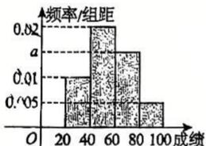
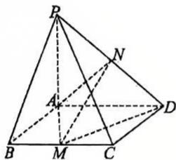
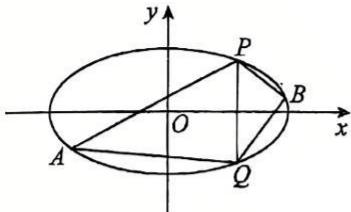

# 2026学年第一学期高三数学综合练习（一）

## 一、填空题：

**1.** 已知集合 $M=\{-1,1,3\}$，$N=\{x \mid y=\sqrt{1-x}\}$，则 $M\cap N=$ \____.

作答区

**2.** 已知 $\mathrm{i}$ 为虚数单位，复数 $z$ 满足 $z(1+\mathrm{i})=(2-\mathrm{i})^{2}$，则 $|z|=$ \____.

作答区

**3.** 已知一组数据为 $1,1,3,4,5$，则这组数据的第 70 百分位数是 \____.

作答区

**4.** 若抛物线的准线方程为 $x=-1$，则该抛物线的标准方程为 \____.

作答区

**5.** 已知 $\sin\alpha=\dfrac{4}{5}$，则 $\cos\left(\alpha+\dfrac{\pi}{2}\right)=$ \____.

作答区

**6.** $\left(x-\dfrac{1}{x}\right)^{10}$ 的二项展开式中常数项为 \____.

作答区

**7.** 已知向量 $\vec{a}=(3,2)$，$\vec{b}=(1,1)$，则 $\vec{a}$ 在 $\vec{b}$ 方向上的投影向量的坐标为 \____.

作答区

**8.** 某校高三年级有 400 名学生，将某次考试的数学成绩绘制成频率分布直方图，如图所示，则此次考试的数学成绩位于区间 $[60,80)$ 的人数约为 \____.

作答区

**9.** 已知集合 $A=\{x \mid x^{2}>4\}$，$B=\{x \mid |x-a|<3\}$，若 $A\cup B=\mathbb{R}$，则实数 $a$ 的取值范围为 \____.

作答区

**10.** 已知 $x>0$，$y>0$，且 $\lg x+\lg y=2$，则 $\dfrac{9}{x}+\dfrac{1}{y}$ 的最小值为 \____.

作答区

**11.** 已知双曲线 $E:\dfrac{x^{2}}{a^{2}}-\dfrac{y^{2}}{b^{2}}=1\ (a>0,\ b>0)$ 的左、右焦点分别为 $F_{1}$、$F_{2}$，过左焦点 $F_{1}$ 作直线 $l$ 与双曲线交于 $A$、$B$ 两点（$B$ 在第一象限），若线段 $AB$ 的中垂线经过点 $F_{2}$，且点 $F_{2}$ 到直线 $l$ 的距离为 $\sqrt{5}a$，则双曲线的离心率为 \____.

作答区

**12.** 若函数 $y=\begin{cases}\dfrac{5x^{3}}{\mathrm{e}^{x}},&x\geqslant 0\\[4pt] 2ax^{2},&x<0\end{cases}$ 的图象上点 $A$ 与点 $B$、点 $C$ 与点 $D$ 分别关于原点对称（以上 4 点不重合），除此之外，函数的图象上不存在其它两点关于原点对称，则实数 $a$ 的取值范围为 \____.

作答区

## 二、选择题：

**13.** “$a>b$”是“$\lg a>\lg b$”的（　　）.

A. 充分不必要条件

B. 必要不充分条件

C. 充要条件

D. 既不充分也不必要条件

作答区

**14.** 函数 $y=\dfrac{3^{x}-1}{3^{x}+1}$ 在定义域 $\mathbb{R}$ 上是（　　）

A. 严格增的奇函数

B. 严格增的偶函数

C. 严格减的奇函数

D. 严格减的偶函数

作答区

**15.** 已知 $F$ 是椭圆 $C_{1}:\dfrac{x^{2}}{4}+\dfrac{y^{2}}{3}=1$ 与抛物线 $C_{2}:y^{2}=2px\ (p>0)$ 的一个共同焦点，$C_{1}$ 与 $C_{2}$ 相交于 $A$、$B$ 两点，则线段 $AB$ 的长等于（　　）

A. $\dfrac{2}{3}\sqrt{6}$　　B. $\dfrac{4}{3}\sqrt{6}$　　C. $\dfrac{5}{3}$　　D. $\dfrac{10}{3}$

作答区

**16.** 记函数 $y_{1}=f_{1}(x)$，$x\in D$，函数 $y_{2}=f_{2}(x)$，$x\in D$，若对任意的 $x\in D$，总有 $|f_{2}(x)|\leqslant|f_{1}(x)|$ 成立，则称函数 $f_{1}(x)$ 包裹函数 $f_{2}(x)$. 判断如下两个命题真假：

①函数 $f_{1}(x)=kx$ 包裹函数 $f_{2}(x)=x\cos x$ 的充要条件是 $|k|\geqslant 1$；

②若对于任意 $p>0$，$|f_{1}(x)-f_{2}(x)|<p$ 对任意 $x\in D$ 都成立，则函数 $f_{1}(x)$ 包裹函数 $f_{2}(x)$.

则下列选项正确的是（　　）

A. ①真②假　　B. ①假②真　　C. ①②全假　　D. ①②全真

作答区

## 三、解答题：

**17.** 已知集合 $A=\left\{x \mid \dfrac{x}{x-2}>2\right\}$，$B=\{x \mid 0<2x-a<4\}$.

（1）当 $a=2$ 时，求 $\overline{A}\cap B$，$A\cup\overline{B}$；

（2）若“$x\in\overline{A}$”是“$x\in B$”的必要不充分条件，求实数 $a$ 的取值范围.

作答区

**18.** 如图，在四棱锥 $P-ABCD$ 中，底面 $ABCD$ 是边长为 2 的正方形，$M$、$N$ 分别为 $BC$、$PD$ 中点.

（1）求证：$MN\parallel$ 平面 $PAB$；

（2）若 $PA=AB$，$PA\perp$ 平面 $ABCD$，求直线 $MD$ 与平面 $AMN$ 所成角的正弦值.

作答区

**19.** 交通部门经过长期观测得到：在交通繁忙的时段内，某公路汽车的车流量 $y$（千辆/时）与汽车的平均速度 $v$（千米/时）之间的函数关系为 $y=\begin{cases}\dfrac{144}{379}v,&v\in[0,30]\\[4pt] \dfrac{144v}{v^{2}-58v+1225},&v\in(30,+\infty)\end{cases}$.

（1）该时段内当汽车的平均速度为多少时，车流量最大？最大车流量是多少？

（2）若要求在该时段内车流量超过 9 千辆/时，则汽车的平均速度应在什么范围？

（以上两小题结果均精确到个位）

作答区

**20.** 已知椭圆 $C$ 的中心在原点，焦点在 $x$ 轴上，离心率为 $\dfrac{1}{2}$，短轴长为 $4\sqrt{3}$.

（1）求椭圆 $C$ 的标准方程；

（2）直线 $x=2$ 与椭圆 $C$ 交于 $P$、$Q$ 两点，$A$、$B$ 是椭圆 $C$ 上位于直线 $PQ$ 两侧的动点，且直线 $AB$ 的斜率为 $\dfrac{1}{2}$.

①求四边形 $APBQ$ 的面积的最大值；

②设直线 $PA$ 的斜率为 $k_{1}$，直线 $PB$ 的斜率为 $k_{2}$，判断 $k_{1}+k_{2}$ 的值是否为常数，并说明理由.

作答区

**21.** 已知函数 $f(x)=x^{2}-ax-a$，其中 $a\in\mathbb{R}$.

（1）若 $a=1$，求函数 $f(x)$ 的图像在 $x=1$ 处的切线方程；

（2）若函数 $F(x)=x\cdot f(x)$ 在 $x=1$ 处有极值，且关于 $x$ 的方程 $F(x)+m=0$ 有 3 个不同的实根，求实数 $m$ 的取值范围；

（3）设函数 $g(x)=-\mathrm{e}^{x}$（$\mathrm{e}$ 为自然常数）. 若对任意 $x_{1}$，$x_{2}\in[0,\mathrm{e}]$，当 $x_{1}>x_{2}$ 时，均有 $|f(x_{1})-f(x_{2})|<|g(x_{1})-g(x_{2})|$ 成立，求实数 $a$ 的取值范围.

---

作答区

